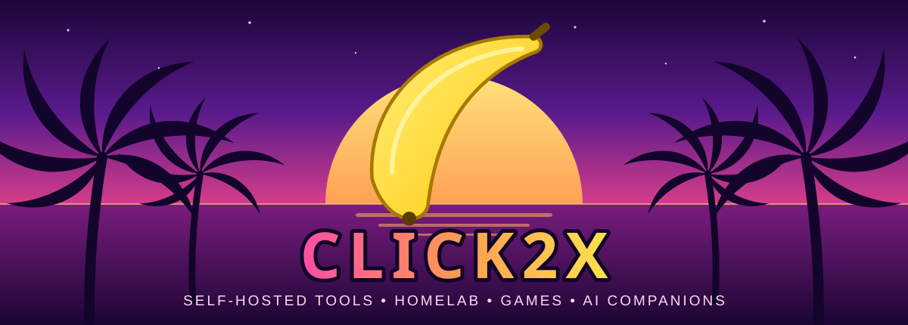

<h1 align="center">🍌 Bryant Oliveira</h1>

<b>Builder of self-hosted tools, homelab projects, game utilities and small games for real life.</b> Free and open source. Built with AI assistance, with full credit to everyone I build on.

---

## 🌴 MISSION SELECT

| | Mission | Briefing |
|---|---|---|
| 🍌 | **[Banana Theft Auto](https://github.com/Click2x/BananaTheftAuto)** | A guided Windows menu for building Leonida (a GTA VI static recompilation) from your own copy of the game. It checks your PC, asks before installing tools, and starts the build. Full credit to Leonida's authors. |
| 🐴 | **[Epona](https://github.com/Click2x/Epona)** | A transparent, menu-driven fork of Hookshot (Ocarina of Time, native PC) with setup checks, a visible list of everything it downloads, builder logging and a safer updater. Full credit to NotRexed. |
| 🟣 | **[Nova.Ai](https://github.com/Click2x/NovaAI)** | A private, local AI companion for your desktop: a glowing orb (or your own VRM avatar) that talks and listens, with model routing, safety filters, editable memory and a guided, voiced setup. |
| 🏰 | **[LifeQuest](https://github.com/Click2x/lifequest)** `beta` | A self-hosted life coach that plays like a classic turn-based JRPG: habits, tasks, money and planning on your phone, a friend party, and a daily AI-written D&D episode starring your hero. No cloud, no dependencies. |
| ⚓ | **[Homeport](https://github.com/Click2x/homeport)** `alpha` | A guided, auto-wired media stack for Docker: Sonarr, Radarr, Prowlarr, Jellyfin and Seerr behind a VPN gate, with WireGuard remote access. No YAML, no copying API keys. |
| 🗓️ | **[Claude Calendar kit](https://github.com/Click2x/claude-calendar-kit)** | One shared task calendar for all your projects, built for Claude Code: lanes, dependencies, a review queue, automatic follow-ups and a `/next` command. |
| ⌨️ | **[physkb](https://github.com/Click2x/physkb)** | Re-sends injected keyboard and mouse input (Parsec, macros, remapping) through the Interception driver so Windows apps see it as physical input. |

**Coming soon:** 🌟 **Supernova** (an open-source app hub that checks every Docker stack against a policy before it runs), 🏰 **Hearthdeep** (a cozy multiplayer dungeon-and-town game in Unity) and 🎬 **Code+Heart** (my video and creator brand).

## 🌅 ON THE RUN

- Keeping Banana Theft Auto's menu easy to use for anyone building Leonida
- Giving LifeQuest a Final Fantasy-style UI, one shippable phase at a time ([plan](https://github.com/Click2x/lifequest/blob/main/docs/UI-REFRESH.md))
- Letting Claude run background work across projects without losing time: the [Claude Calendar kit](https://github.com/Click2x/claude-calendar-kit)

## 🕶️ LOADOUT

## ☕ SUPPORT THE HEIST

Everything I publish is free. Building and testing it takes time and hardware, so if something saved you time or you want to see more of it, a coffee helps keep the projects going. Thank you. 💙

&nbsp;&nbsp;

---

The game-related projects contain no game files and never download or share any. They are unofficial fan projects, not affiliated with Rockstar Games, Take-Two or Nintendo. Grand Theft Auto and related names belong to their owners.
